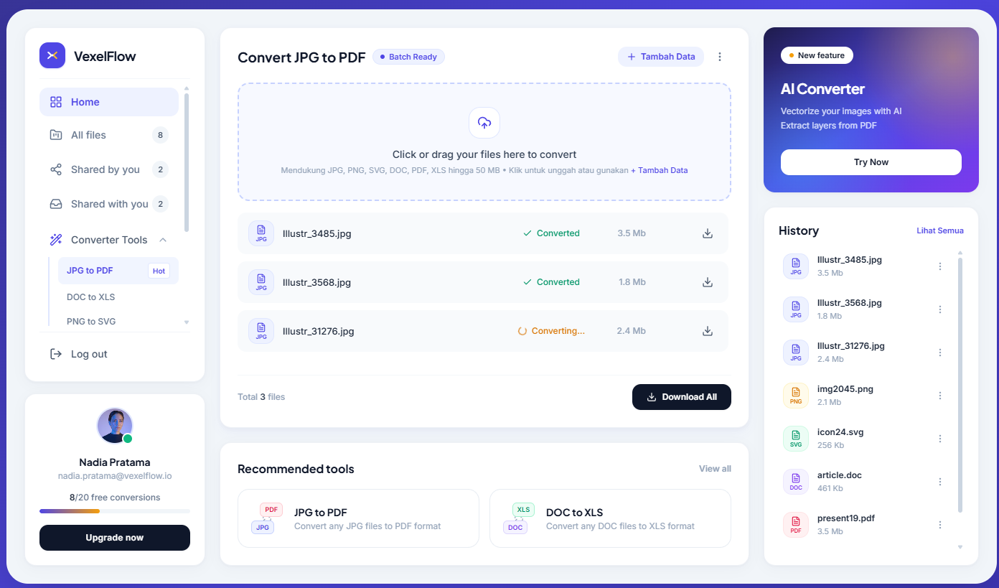

# VexelFlow

Template dashboard frontend untuk workspace konversi file. Dibuat sebagai static website yang bisa dibuka langsung di browser dan dipublikasikan melalui GitHub Pages.



## Fitur

- Dashboard responsive untuk desktop, tablet, dan mobile.
- Upload area drag-and-drop dengan validasi format dan ukuran file.
- Queue konversi demo JPG, PNG, SVG, DOC, PDF, dan XLS.
- History, file table, filter, sorting, pagination, dan bulk actions.
- Navigasi converter tools: JPG to PDF, DOC to XLS, dan PNG to SVG.
- State demo tersimpan di `localStorage`.
- Tidak membutuhkan build step atau backend untuk preview.

> **Catatan template:** proses konversi, download, sharing, upgrade, dan AI Converter pada template ini adalah simulasi frontend. Hubungkan ke API/backend sebelum digunakan sebagai produk produksi.

## Struktur

```text
.
├── assets/
│   ├── css/
│   │   └── styles.css
│   ├── img/
│   │   └── preview.png
│   └── js/
│       └── app.js
├── index.html
├── LICENSE
└── README.md
```

## Menjalankan lokal

Tidak ada dependency install.

```bash
python -m http.server 8000
```

Buka `http://localhost:8000`.

## Deploy ke GitHub Pages

1. Push branch `main` ke GitHub.
2. Buka **Settings → Pages** dan pilih **GitHub Actions** sebagai source.
3. Workflow `.github/workflows/pages.yml` mempublikasikan `index.html` dan `assets/` setiap push ke `main`.
4. URL publik: https://laluarifta.github.io/vexel-convert/ (tersedia setelah deployment berhasil).

## Lisensi

MIT. Lihat [LICENSE](LICENSE).
